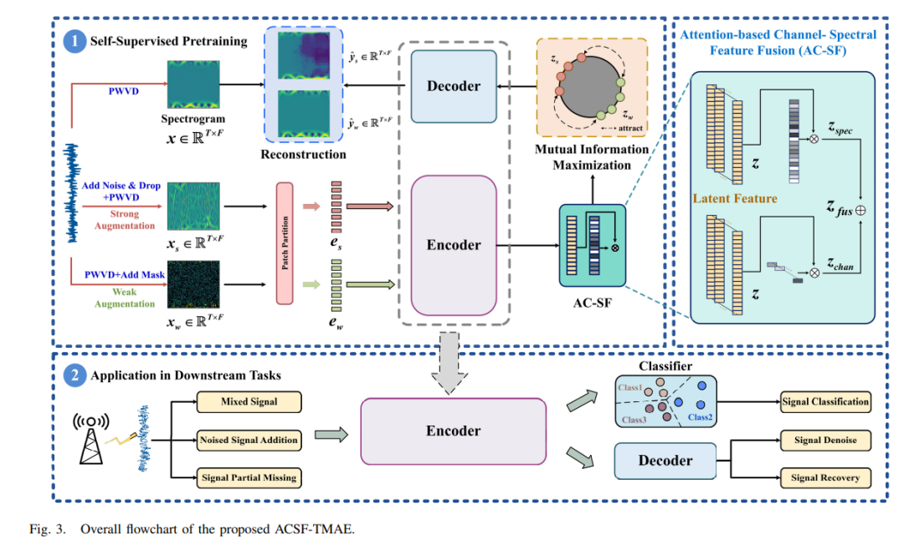
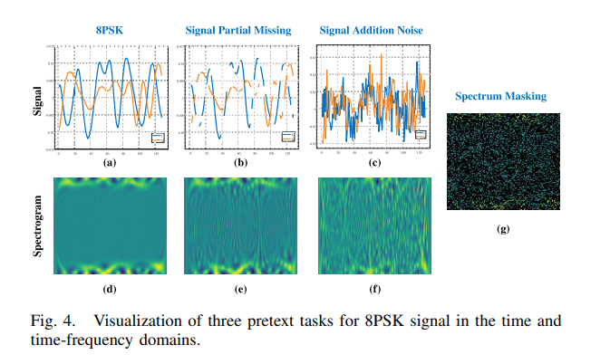
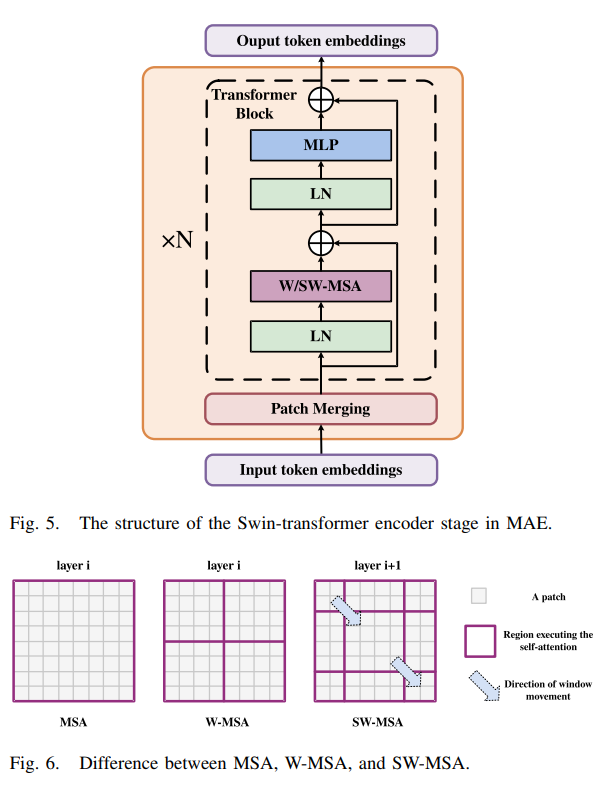
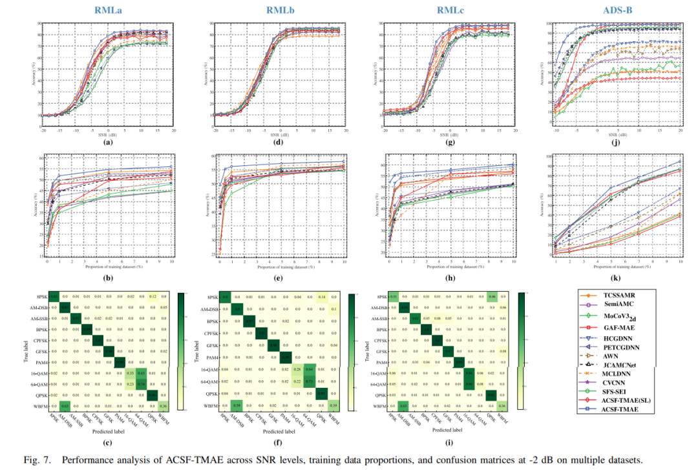
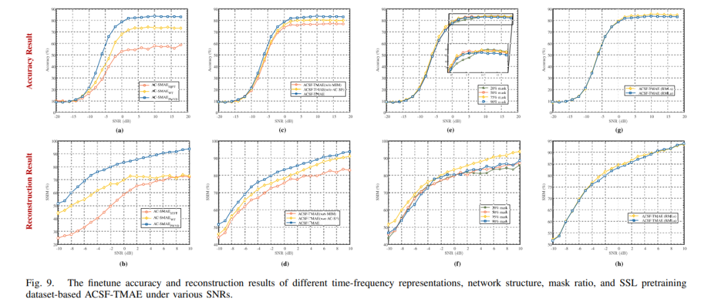

# Cognitive Radio - Generative Self-Supervised Framework Based on Time-Frequency Features and Attention Fusion[with Python Code]

With the development of cognitive radio technology (CRT) in wireless communication networks, deep learning (DL) plays a significant role in enhancing spectrum efficiency. However, supervised learning methods require large amounts of labeled data and are costly in terms of labor, making it increasingly necessary for CRT applications to learn robust representations from unlabeled data. Although recent advances in DL have propelled the application of self-supervised learning (SSL) based on time-domain contrastive methods in CRT, these methods often fail to extract advanced spectral representations due to their neglect of time-frequency features.
To address this issue, this paper proposes a generative SSL framework suitable for CRT. Firstly, by using a mask autoencoder (MAE) to reconstruct the masked spectrum graph, SSL pretraining is conducted in both the time-frequency domain; secondly, to recover spectral graphs under extreme wireless environments, mutual information maximization is utilized to extract high-level spectral information obscured by noise; additionally, an attention-based channel-spectrum fusion module is designed to automatically extract and fuse features from the channel and spectrum domains.
The feasibility of the framework has been validated through multiple downstream tasks on four public datasets. Experimental results show that the proposed framework significantly outperforms existing methods across various downstream tasks.
Introduction Research background and challenges With the proliferation of wireless devices and the increasing scarcity of spectrum resources, the management and optimization of limited wireless network resources face significant challenges. Cognitive radio technology (CRT) becomes an effective solution for spectrum sharing optimization and improving communication quality by real-time monitoring, analysis, and utilization of wireless spectrum. In key tasks of CRT such as radio signal classification, signal denoising, and partial signal loss recovery, ML and DL not only identify modulation schemes but also enhance spectrum allocation efficiency. However, traditional ML methods are affected by increased device internal noise and interference sources, making accurate radio cognitive challenging.
The DL method has shown significant potential by learning complex nonlinearities and high-dimensional features from data. However, supervised learning (SL) heavily relies on large amounts of labeled data, which are often difficult to obtain and costly in wireless communication scenarios. This greatly limits the practical deployment of supervised DL models, especially in scenarios with scarce labeled data.
The development and limitations of self-supervised learning (SSL) as an effective solution to the problem of limited labeled data. SSL methods acquire feature representations through pre-training models and then transfer them to downstream tasks. The existing SSL methods in CRT have the following limitations:
Single downstream task:
Comparative SSL methods such as MoCo and SimCLR learn feature representations through comparing positive and negative samples, but their downstream tasks are limited to signal classification (RSC), failing to meet multitask requirements.
Insufficient time-frequency feature extraction:
Generative SSL methods such as MAE focus on the latent representations and global distribution of data, but the basic Transformer model lacks understanding of signal modulation information and channel characteristics, making it difficult to extract advanced spectral features.
Feature extraction challenges under extreme conditions:
In extreme scenarios like low SNR and high data loss rates, generative SSL models struggle to converge or recover input samples due to insufficient feature extraction and noise interference.
This paper contributes to the design of the Attention Channel - Spectrum Fusion Transformer (ACSF-TMAE) framework based on attention channels - spectrum fusion. The main contributions include:
Integrating the time-frequency characteristics of radio signals into the learning process to capture long-distance spectral feature relationships, achieving flexibility for multiple downstream tasks.
Designing an Attention Channel - Spectrum Fusion (AC-SF) module that automatically extracts features from regions with concentrated spectral energy, enhancing the network's ability to understand and extract important latent features.
Utilizing weakly enhanced latent features to guide the reconstruction of strongly enhanced features through mutual information maximization (MIM) to extract advanced spectral information obscured by noise, providing a theoretical foundation for the reconstruction of strong enhanced samples.
Experiments on four datasets show that the proposed method significantly outperforms other SSL and SL methods in terms of classification accuracy and robustness, even when using only 10% of the data as the training set. It also performs exceptionally well in denoising and missing data recovery tasks.
Article illustration
Conclusion This paper explores the application of time-frequency domain generative SSL framework in CRT, aiming to address the lack of flexibility and generality of existing SSL methods. The proposed ACSF-TMAE framework enhances the understanding of global and local features in the spectrum graph through pre-training, achieving excellent performance in denoising, classification, and signal completion tasks. Specifically:
Utilizing MIM theory, the network is guided to extract long-range spectral feature relationships under low SNR by weakly enhancing latent features, aiding in the extraction of advanced spectral information.
A mechanism for attention integration is designed to address the issue of uneven energy distribution in the spectrum graph, enhancing the network's potential feature extraction capabilities in both the spectrum and channel domains.
Experimental validation shows that the framework can still improve accuracy and generalization performance when only SNR≥6 dB data is pre-trained, supporting flexible downstream task selection.
Future work will focus on further optimizing the classification performance of similar modulation schemes, promoting the widespread application of generative SSL models in CRT.
End

## Images

<!-- PAYMENT_BLOCK -->

## Get this dataset

- Payment link (Stripe): [Buy now](https://buy.stripe.com/3cs8yP7sY87d0vu9AB)
- Payment QR code: 

<!-- /PAYMENT_BLOCK -->
